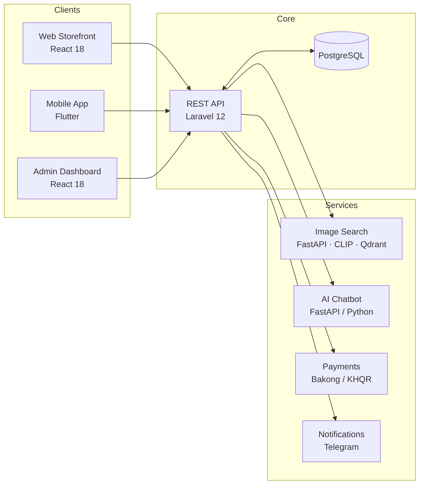

<div align="center">

# The Man Store

### Modern full-stack e-commerce — web, mobile, and AI-powered shopping

[](https://github.com/ousasak/the-man-store)
[](https://github.com/ousasak/the-man-store)

<br />

**Laravel 12** · **React 18** · **Flutter** · **PostgreSQL** · **FastAPI** · **CLIP / Qdrant**

<br />

[Documentation](#-documentation) · [Tech Stack](#-tech-stack) · [Architecture](#-architecture)

</div>

---

## About

**The Man Store** is a premier, general online e-commerce platform built for real-world retail operations — serving a diverse catalog across fashion, lifestyle, and essentials for everyone (Women, Men, Kids, Accessories).

We ship a unified experience across **web storefront**, **admin dashboard**, and **Flutter mobile app**, all powered by a single **Laravel REST API**.

> Shop smarter. Manage faster. Scale with confidence.

---

## Highlights

<table>
<tr>
<td width="50%">

### Storefront & Mobile
- Multi-category product browse, search & filters
- Cart, wishlist & checkout
- Order tracking & replacements
- **Visual search** — find products by photo
- AI shopping assistant

</td>
<td width="50%">

### Admin & Operations
- Products, categories & brands
- Stock, barcodes & QR labels
- Orders, shipments & drivers
- Discounts & promotions
- Reports & analytics

</td>
</tr>
<tr>
<td width="50%">

### Payments & Auth
- **Bakong / KHQR** (Cambodia)
- Laravel Sanctum + email OTP
- Google & Facebook OAuth
- Device-bound sessions

</td>
<td width="50%">

### Integrations
- Telegram notifications & broadcasts
- Google Gemini generative AI
- CLIP + Qdrant image similarity
- Docker Compose dev stack

</td>
</tr>
</table>

---

## Architecture



---

## Tech Stack

| Layer | Technologies |
| :--- | :--- |
| **Backend** | Laravel 12, PHP 8.2+, Sanctum, PostgreSQL |
| **Web** | React 18, Vite, Tailwind CSS |
| **Mobile** | Flutter 3.9+ (iOS, Android, Web) |
| **AI / ML** | Python FastAPI, CLIP, Qdrant, Google Gemini |
| **DevOps** | Docker Compose, Composer, npm |
| **Payments** | Bakong / KHQR gateway |

<p align="center">
  
  
  
  
  
  
  
</p>

---

## Quick Start

```bash
# Clone the repository
git clone https://github.com/ousasak/the-man-store.git
cd the-man-store

# macOS / Linux
sh setup.sh

# Windows
setup.bat
```

| Service | Default URL |
| :--- | :--- |
| API | `http://127.0.0.1:8001` |
| Web (Vite) | `http://127.0.0.1:5173` |
| Flutter web | `http://127.0.0.1:3000` |

---

## Documentation

| Topic | Description | Link |
| :--- | :--- | :--- |
| **System Architecture** | Client–server design, components & integrations | [docs/architecture/SystemArchitecture.md](docs/architecture/SystemArchitecture.md) |
| **Entity Relationship Diagram** | Relational database schema & Chen ERD | [docs/database/ERD.md](docs/database/ERD.md) |
| **Data Dictionary** | Table structures, fields, types & constraints | [docs/database/DataDictionary.md](docs/database/DataDictionary.md) |
| **Data Flow Diagram** | Context & process-level DFD | [docs/dfd/DFD.md](docs/dfd/DFD.md) |
| **Visual Image Search** | CLIP / Qdrant visual product search | [docs/ai/IMAGE_SEARCH_GUIDE.md](docs/ai/IMAGE_SEARCH_GUIDE.md) |
| **Documentation Hub** | Complete table of contents & all guides | [docs/README.md](docs/README.md) |

---

<div align="center">

**The Man Store** — built with care for modern retail.

<br />

<sub>© The Man Store. All rights reserved.</sub>

</div>
