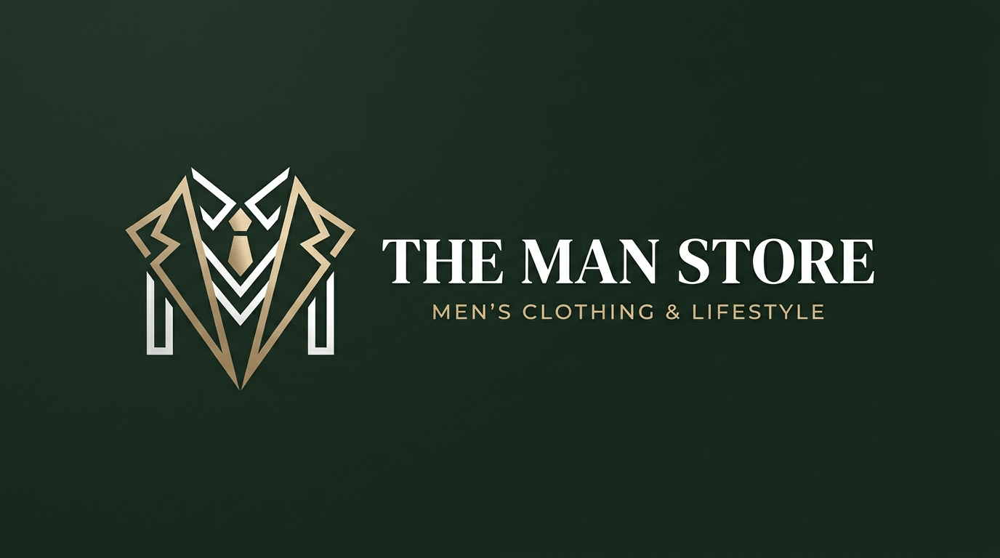
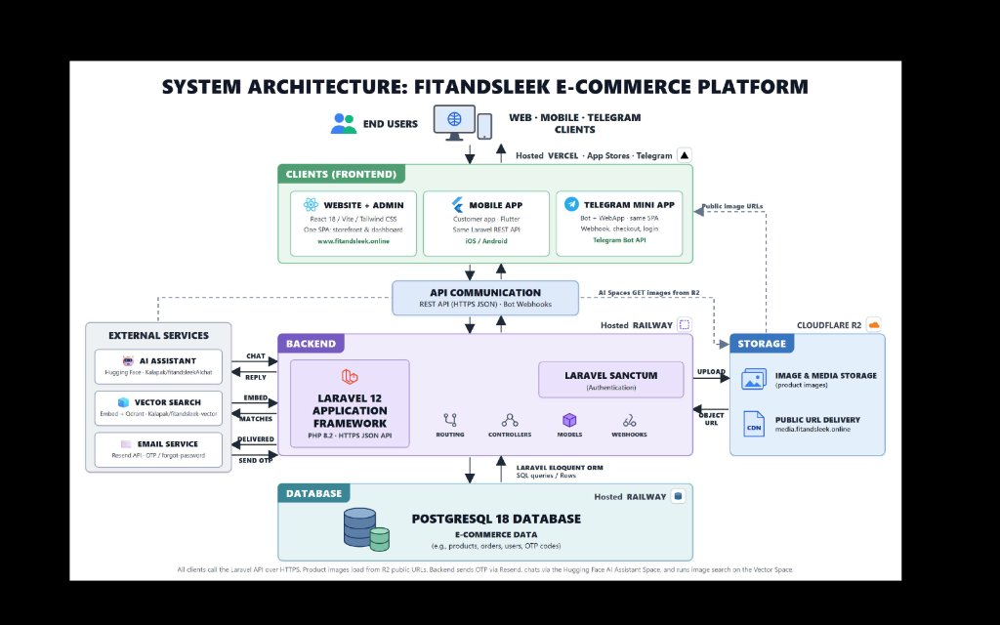

# the-man-store

<p align="center">
  
  <br/>
  
</p>

<p align="center">
  <strong>Modern Full-Stack E-Commerce &amp; Lifestyle Platform for Everyone</strong>
</p>

<p align="center">
  <a href="#features"></a>
  <a href="#tech-stack"></a>
  <a href="#tech-stack"></a>
  <a href="#tech-stack"></a>
  <a href="#tech-stack"></a>
  <a href="#tech-stack"></a>
  <a href="#license"></a>
</p>

<p align="center">
  <a href="#quick-start">Quick Start</a> •
  <a href="#features">Features</a> •
  <a href="#architecture">Architecture</a> •
  <a href="#documentation">Documentation</a> •
  <a href="#api-reference">API Reference</a> •
  <a href="#deployment">Deployment</a> •
  <a href="#contributing">Contributing</a>
</p>

---

## 📋 Overview

**The Man Store** is a comprehensive, modern e-commerce platform built for general online retail. It combines a powerful **Laravel REST API**, a responsive **React admin dashboard & storefront**, a cross-platform **Flutter mobile app**, and an intelligent **AI chatbot** — all orchestrated through Docker Compose for seamless development and deployment.

Whether you're managing thousands of products, tracking inventory across suppliers, processing orders with multiple payment gateways, or engaging customers through AI-powered chat, The Man Store provides the tools to run a modern online store at scale.

---

## ✨ Features

<table>
<tr>
<td width="50%">

### 🛍️ Storefront
- Product catalog with categories, brands & collections
- Advanced search with image-based product discovery
- Shopping cart & multi-step checkout
- Wishlist & personalized recommendations
- Discount codes & promotional campaigns
- Customer loyalty program & points system

</td>
<td width="50%">

### 🔧 Admin Dashboard
- Real-time sales dashboard & analytics
- Product, category, brand & collection management
- Order processing & shipment tracking
- Inventory management with barcode/QR scanning
- Purchase orders & supplier management
- Customer management & loyalty administration

</td>
</tr>
<tr>
<td width="50%">

### 🤖 AI & Smart Features
- AI-powered customer chatbot (RAG + NLU)
- Image-based product search
- Product taxonomy intelligence
- Text analytics & customer sentiment
- Vector search with Qdrant integration

</td>
<td width="50%">

### 🔐 Security & Operations
- Laravel Sanctum authentication (session + token)
- Two-factor authentication (2FA)
- OAuth social login integration
- Telegram bot notifications & order alerts
- Bakong & COD payment processing
- Role-based access control (RBAC)

</td>
</tr>
</table>

---

## 🏗️ Architecture

<p align="center">
  
</p>

```
the-man-store/
├── backend/                # Laravel 12 REST API
│   ├── app/
│   │   ├── Http/Controllers/   # API, Admin, Storefront & Driver controllers
│   │   ├── Models/             # 40+ Eloquent models
│   │   ├── Services/           # Business logic layer
│   │   ├── Jobs/               # Queue jobs (email, notifications)
│   │   └── Mail/               # Transactional email templates
│   ├── database/
│   │   ├── migrations/         # Schema versioning
│   │   └── seeders/            # Sample data
│   └── routes/api.php          # RESTful route definitions
│
├── frontend/               # React 18 + Vite + Tailwind CSS
│   └── src/
│       ├── pages/              # 70+ pages (admin + storefront)
│       ├── components/         # Reusable UI component library
│       ├── state/              # Global state management
│       └── hooks/              # Custom React hooks
│
├── mobile/                 # Flutter cross-platform app
│   └── lib/
│       ├── screens/            # App screens (shop, auth, profile…)
│       ├── providers/          # State management
│       ├── services/           # API service layer
│       └── widgets/            # Shared widgets
│
├── themanstoreAIchat/      # Python AI chatbot service
│   └── services/               # RAG, NLU, session memory, analytics
│
├── fitandsleek_vector/     # Vector search microservice
│   ├── backend/                # FastAPI + Qdrant
│   └── frontend/               # Next.js search UI
│
├── docker-compose.yml      # Multi-service orchestration
├── scripts/                # DevOps & utility scripts
├── docs/                   # Architecture diagrams & guides
├── setup.bat               # Windows bootstrap
└── setup.sh                # macOS / Linux bootstrap
```

---

## 📖 Documentation

Comprehensive system, database, and process specifications are organized inside the [`docs/`](docs/README.md) hub:

| Category | Key Documents |
|:---|:---|
| **🏛️ Architecture & System Design** | [System Architecture](docs/architecture/SystemArchitecture.md) · [Architecture Diagram](docs/system-architecture-diagram.jpg) |
| **🗄️ Database & Schema** | [Entity Relationship Diagram (ERD)](docs/database/ERD.md) · [Data Dictionary](docs/database/DataDictionary.md) · [Full Chen ERD](docs/database/ERD_all.md) · [Schema Reference](docs/database/Entity_Relationship_Diagram.md) |
| **🔄 Data Flow Diagrams (DFD)** | [Data Flow Diagram (DFD)](docs/dfd/DFD.md) · [Gane & Sarson DFD](docs/dfd/DFD_Gane&Sarson.md) · [Gane & Sarson (CR Edition)](docs/dfd/DFD_Gane&Sarson_CR.md) |
| **🤖 AI & Image Search** | [CLIP Visual Product Search](docs/ai/IMAGE_SEARCH_GUIDE.md) · [Search Refactor Notes](docs/ai/IMAGE_SEARCH_REFACTOR.md) · [Vector Microservice](docs/ai/huggingface-vector-space.md) · [AI Assistant](docs/ai/huggingface-chat-space.md) |
| **🚀 DevOps & Cloud** | [pgAdmin Setup](docs/devops/pgadmin-connection.md) · [Railway PostgreSQL](docs/devops/railway-postgres-try.md) · [Backend API Docs](backend/docs/) |

👉 *Browse the full documentation hub in [**`docs/README.md`**](docs/README.md).*

---

## 🛠️ Tech Stack

| Layer | Technologies |
|:---|:---|
| **Backend** | Laravel 12 · PHP 8.1+ · PostgreSQL · Laravel Sanctum · Queue Workers |
| **Frontend** | React 18 · Vite · Tailwind CSS · ShadCN UI · Framer Motion |
| **Mobile** | Flutter 3 · Dart · Provider State Management |
| **AI Services** | Python · FastAPI · Qdrant · HuggingFace · RAG Pipeline |
| **Payments** | Bakong QR · Cash on Delivery (COD) |
| **Notifications** | Telegram Bot API · Email (Laravel Mail) |
| **DevOps** | Docker Compose · Cloudflare Tunnel · pgAdmin |

---

## 🚀 Quick Start

### Prerequisites

| Tool | Version |
|:---|:---|
| PHP | 8.1+ |
| Composer | Latest |
| Node.js | 18+ |
| PostgreSQL | 13+ |
| Docker Desktop | Latest (recommended) |
| Flutter SDK | Latest (mobile only) |

### One-Command Setup

**Windows**
```bat
setup.bat
```

**macOS / Linux**
```bash
sh setup.sh
```

The setup script will:
1. Create `backend/.env` from `.env.example`
2. Install PHP and Node.js dependencies
3. Generate the application key
4. Run database migrations
5. Start all services via Docker Compose

### Default Service URLs

| Service | URL | Description |
|:---|:---|:---|
| 🔌 API | `http://127.0.0.1:8001` | Laravel REST API |
| 🌐 Web App | `http://127.0.0.1:5173` | React storefront & admin |
| 📱 Mobile Web | `http://127.0.0.1:3000` | Flutter web preview |

---

## 📖 Manual Setup

<details>
<summary><strong>Backend (Laravel API)</strong></summary>

```bash
cd backend
composer install
cp .env.example .env
php artisan key:generate
php artisan migrate --seed
php artisan storage:link
php artisan serve
```

</details>

<details>
<summary><strong>Frontend (React + Vite)</strong></summary>

```bash
cd frontend
npm install
npm run dev
```

</details>

<details>
<summary><strong>Mobile (Flutter)</strong></summary>

```bash
cd mobile
flutter pub get
flutter run -d web-server --web-port=3000 --web-hostname=0.0.0.0
```

</details>

<details>
<summary><strong>AI Chatbot Service</strong></summary>

```bash
cd themanstoreAIchat
pip install -r requirements.txt
python app.py
```

Or via Docker:
```bash
cd themanstoreAIchat
docker compose up -d
```

</details>

---

## ⚙️ Environment Variables

### Backend — `backend/.env`

| Variable | Description |
|:---|:---|
| `APP_URL` | Application base URL |
| `DB_HOST`, `DB_PORT`, `DB_DATABASE` | PostgreSQL connection |
| `DB_USERNAME`, `DB_PASSWORD` | Database credentials |
| `MAIL_*` | SMTP / email configuration |
| `TELEGRAM_BOT_TOKEN` | Telegram bot integration |

> [!CAUTION]
> Never commit `.env` files containing secrets to version control.

### Frontend — `frontend/.env`

```env
VITE_API_BASE_URL=http://127.0.0.1:8001/api
VITE_BACKEND_ORIGIN=http://127.0.0.1:8001
```

---

## 🐳 Docker

**Light dev stack** — PostgreSQL + API + Frontend:
```bash
pwsh scripts/docker-up.ps1
```

**Full stack** — adds Queue, Scheduler, Qdrant, AI service, pgAdmin:
```bash
pwsh scripts/docker-up.ps1 -Mode full
```

**Using Compose directly:**
```bash
# Light stack
docker compose up -d --build --remove-orphans

# Full stack (all profiles)
docker compose --profile full up -d --build

# Stop everything
docker compose down
```

---

## 📡 API Reference

### Authentication

| Method | Endpoint | Description |
|:---|:---|:---|
| `POST` | `/api/auth/register` | Register a new customer |
| `POST` | `/api/auth/login` | Log in & receive token |
| `POST` | `/api/auth/logout` | Revoke current session |
| `GET` | `/api/me` | Get authenticated user profile |
| `POST` | `/api/auth/2fa/verify` | Verify two-factor code |

### Catalog

| Method | Endpoint | Description |
|:---|:---|:---|
| `GET` | `/api/categories` | List all categories |
| `GET` | `/api/products` | List products (paginated, filterable) |
| `GET` | `/api/products/{slug}` | Product detail by slug |
| `GET` | `/api/brands` | List all brands |
| `GET` | `/api/collections` | List product collections |

### Shopping

| Method | Endpoint | Description |
|:---|:---|:---|
| `GET` | `/api/cart` | View current cart |
| `POST` | `/api/cart/items` | Add item to cart |
| `POST` | `/api/checkout` | Place an order |
| `GET` | `/api/orders` | List customer orders |
| `GET` | `/api/wishlist` | View wishlist |

### Admin

| Method | Endpoint | Description |
|:---|:---|:---|
| `GET` | `/api/admin/dashboard` | Dashboard analytics |
| `CRUD` | `/api/admin/products` | Manage products |
| `CRUD` | `/api/admin/categories` | Manage categories |
| `CRUD` | `/api/admin/orders` | Manage orders |
| `CRUD` | `/api/admin/inventory` | Stock & inventory |
| `CRUD` | `/api/admin/suppliers` | Supplier management |
| `CRUD` | `/api/admin/discounts` | Discount campaigns |

---

## 🗄️ Database

- **Migrations:** `backend/database/migrations/` — versioned schema changes
- **Seeders:** `backend/database/seeders/` — sample & test data
- **40+ Models:** Products, Orders, Inventory, Payments, Users, Loyalty, Shipments, and more

### Key Models

```
User ─── Cart ─── CartItem ─── Product ─── Category
  │                                │           │
  ├── Order ─── OrderItem ─────────┘           │
  │    └── Payment                        Brand
  │    └── Shipment                   Collection
  │                                    Discount
  ├── WishlistItem
  ├── LoyaltyProfile
  └── Address
```

---

## 🧪 Development Commands

<table>
<tr>
<td>

**Backend**
```bash
cd backend
php artisan serve          # Start dev server
php artisan migrate        # Run migrations
php artisan migrate:fresh --seed  # Reset & seed DB
php artisan test           # Run test suite
php artisan queue:work     # Start queue worker
```

</td>
<td>

**Frontend**
```bash
cd frontend
npm run dev       # Start Vite dev server
npm run build     # Production build
npm run preview   # Preview production build
npm run lint      # Lint check
```

</td>
</tr>
</table>

---

## 🔍 Troubleshooting

<details>
<summary><strong>Common Issues</strong></summary>

| Issue | Solution |
|:---|:---|
| README or repo looks broken on GitHub | Ensure `README.md` is UTF-8 with normal line breaks (no binary/null bytes). |
| `frontend/` shows as a submodule | Remove nested `frontend/.git` and recommit frontend as normal files. |
| `npm install` or `composer install` fails | Verify Node.js (18+), npm, PHP (8.1+), and Composer versions match prerequisites. |
| Database connection error | Check `DB_*` settings in `backend/.env`. Ensure PostgreSQL is running. |
| CORS / API errors | Verify `VITE_API_BASE_URL` and `VITE_BACKEND_ORIGIN` in `frontend/.env`. |
| Docker containers won't start | Run `docker compose down -v` then `docker compose up -d --build`. |
| AI chatbot not responding | Ensure the AI service is running and Qdrant is accessible. |

</details>

---

## 🤝 Contributing

We welcome contributions! Please follow these guidelines:

1. **Fork** the repository and create a feature branch from `main`
2. **Keep commits focused** — one logical change per commit
3. **Write tests** for new features and bug fixes
4. **Run the full test suite** and build before opening a PR
5. **Request a review** from at least one team member before merge

> [!NOTE]
> Please open an issue first to discuss major changes before submitting a pull request.

---

## 👥 Team

**Group 64** — Project Standard 2026

---

## 📄 License

All rights reserved. This project and its source code are proprietary unless stated otherwise by the repository owner.

---

<p align="center">
  Built with ❤️ by the <strong>The Man Store</strong> team
</p>
